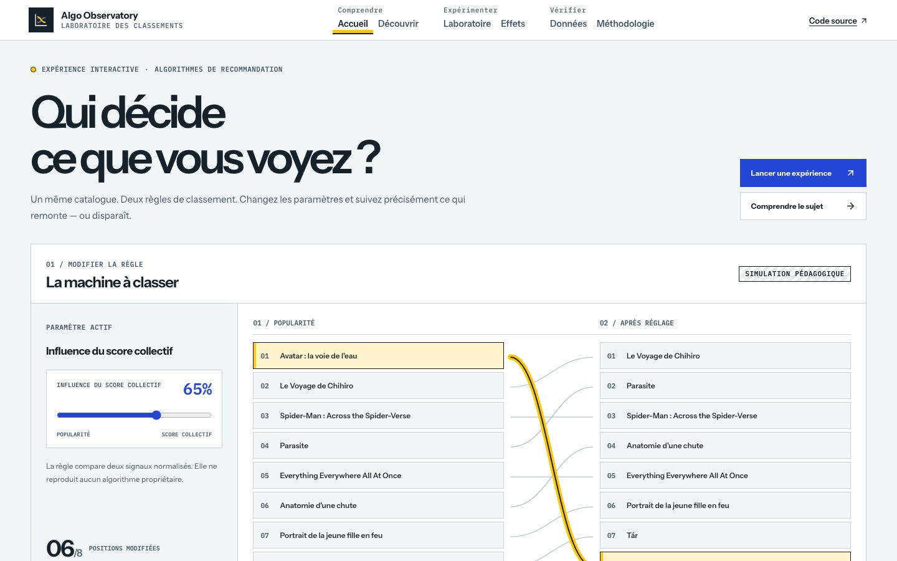
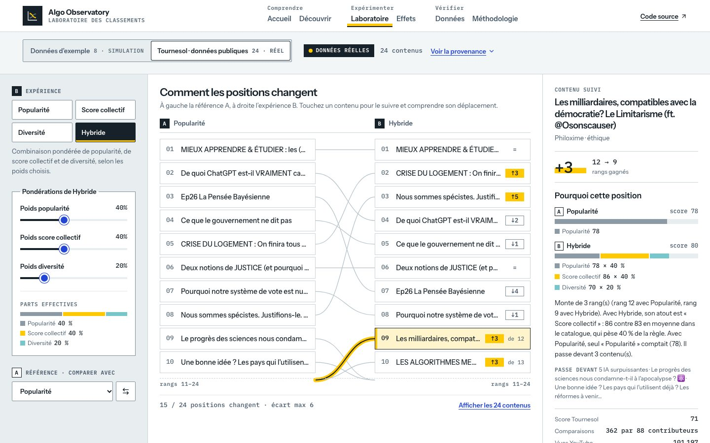
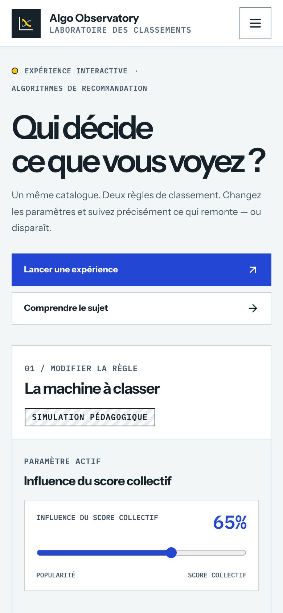

# Algo Observatory

**Qui décide de ce que vous voyez ?** Un laboratoire open source pour rendre les algorithmes de recommandation compréhensibles et comparables, plutôt que de les traiter comme des boîtes noires.

[**Essayer la démo publique**](https://guillaume-flambard.github.io/algo-observatory/) · [Ouvrir le laboratoire](https://guillaume-flambard.github.io/algo-observatory/#/lab) · [Examiner la méthode](https://guillaume-flambard.github.io/algo-observatory/#/methodology)



<table>
  <tr>
    <td width="70%">
      
    </td>
    <td width="30%">
      
    </td>
  </tr>
  <tr>
    <td><small>Comparaison interactive sur des données Tournesol publiques et datées.</small></td>
    <td><small>Interface mobile, accessible au clavier et aux technologies d’assistance.</small></td>
  </tr>
</table>

## Pourquoi ce projet existe

Les règles de recommandation influencent la visibilité des contenus. Mais il est difficile de distinguer les **métriques d’entrée**, les **règles de classement** et les **résultats observés**. Algo Observatory permet de modifier explicitement les règles et de suivre leurs conséquences sur un même catalogue.

**Ce n’est pas un simulateur officiel des algorithmes de YouTube ni un outil de mesure du comportement d’une plateforme réelle.** Chaque expérience affiche sa source et la frontière entre données observées et classement simulé.

## Explorer l’application

| Espace | À découvrir |
| --- | --- |
| **Accueil** | Deux ordres pour un même catalogue pédagogique |
| **Découvrir** | Explications accessibles des mécanismes de recommandation |
| **Laboratoire** | Popularité, score collectif, diversité et hybride ; pondérations et explications des rangs |
| **Effets** | Trajectoires de classement, hypothèses et limites d’interprétation |
| **Données** | Recherche, filtres, tri par métriques, export CSV protégé |
| **Méthodologie** | Provenance, licences, fraîcheur, transformations et reproductibilité |

### Des données publiques réellement traçables

Le laboratoire contient un **instantané de 24 recommandations publiques Tournesol**, collectées le **25 octobre 2026** sous licence **ODC-BY 1.0**. Les identifiants, titres, vues et scores sont conservés dans [la capture versionnée](src/core/data/tournesol-public-snapshot.json).

Les métriques d’expérience sur l’échelle de 0 à 1 sont dérivées de ces données : les règles exactes sont dans [tournesol-public.ts](src/core/data/tournesol-public.ts). Elles **ne représentent pas un classement réellement observé chez YouTube**. Le catalogue d’exemple est explicitement marqué *simulation*.

Le jeu Tournesol fonctionne sans appel navigateur à l’API externe et peut être actualisé volontairement avec `node scripts/refresh-tournesol.mjs` après vérification des données récupérées.

## Frontend, ingénierie et qualité

- **React 19, TypeScript strict, Vite 6**, Tailwind CSS et Lucide.
- Modules chargés à la demande (`React.lazy`), navigation responsive et navigation directe par URL.
- Modèles de classement déterministes, explications des scores et graphes de trajectoires utilisables sur desktop comme sur mobile.
- Accessibilité : focus clavier, contrastes, état des contrôles, réduction du mouvement et tests automatisés WCAG 2.2 AA avec axe.
- Tests : Vitest/Testing Library et **Playwright sur Chromium et WebKit**, formats desktop et mobile.
- CI : lint, typage, tests, build normal et Pages, budget du JavaScript initial (**100 Ko gzip**) et du CSS (**12 Ko gzip**), puis déploiement GitHub Pages seulement après validation.

**Audit ponctuel de la démo, 25 octobre 2026 :** Lighthouse mobile 12.8.2 — performance **100**, accessibilité **100**, bonnes pratiques **100**, SEO **100**. Ces valeurs proviennent d’un test synthétique unique, pas de métriques d’utilisateurs réels ; elles peuvent varier selon le matériel, le réseau et la version du navigateur.

## Développement local

Node.js 22+ et pnpm 10.14+ :

```bash
pnpm install --frozen-lockfile
pnpm dev
```

Vérifier :

```bash
pnpm lint:check
pnpm types:check
pnpm test
pnpm build
pnpm exec playwright install chromium webkit
pnpm test:e2e
pnpm build:pages
```

Le projet se découpe en `src/features/` (interfaces), `src/core/data/` (jeu de données et stratégies), `src/core/adapters/` (adaptateurs) et `tests/e2e/` (parcours navigateur). Le graphe interactif se trouve dans [RankLedger.tsx](src/features/lab/RankLedger.tsx). Un résumé pour les modèles de langage est publié en [llms.txt](public/llms.txt).

## Contribuer

Les contributions portant sur l’accessibilité, l’explicabilité, les référentiels publics et les tests de reproductibilité sont les bienvenues. Voir [CONTRIBUTING.md](docs/CONTRIBUTING.md).

Projet indépendant : aucune affiliation ou partenariat officiel avec Tournesol, YouTube ou Data for Good n’est revendiqué.

## Licence

Code sous licence [MIT](LICENSE). Données Tournesol de l’instantané sous [ODC-BY 1.0](https://opendatacommons.org/licenses/by/1-0/), avec attribution à Tournesol. Polices sous SIL Open Font License 1.1.

## Local pre-commit checks

After cloning, run `pnpm install` or `pnpm hooks:install`.
The versioned Git hook rejects staged whitespace and credential-like files,
then runs ESLint and TypeScript checks on source changes. Playwright and build
checks stay in CI. Existing custom Git hook paths are preserved.
